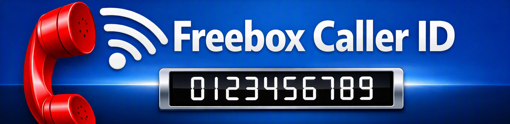

# Freebox Caller ID - Home Assistant Integration

[](https://github.com/MadMatt34/ha-freebox-caller-id/releases)
[](https://www.home-assistant.io/)
[](https://www.home-assistant.io/docs/quality_scale/#-silver)
[](https://github.com/hacs/default)

\
[](https://github.com/MadMatt34/ha-freebox-caller-id/actions/workflows/hacs.yml)
[](https://github.com/MadMatt34/ha-freebox-caller-id/actions/workflows/hassfest.yml)
[](https://github.com/MadMatt34/ha-freebox-caller-id/actions/workflows/tests.yml)
[](https://github.com/MadMatt34/ha-freebox-caller-id/actions/workflows/tests.yml)



[❗README en FRANCAIS 🇫🇷 ❗](README.fr.md)

**Freebox Caller ID** is a custom Home Assistant integration designed to detect incoming calls on your [Freebox](https://www.free.fr/freebox) landline **in real-time**, without requiring any additional hardware.

---

## ⚡ Main Features

By default, the [Freebox OS API](https://dev.freebox.fr/sdk/os/) does not send push notifications when a phone rings. However, the Freebox immediately registers incoming calls in its call log (`/api/v4/call/log/`) upon the very first ring with a duration of `0`. This integration performs fast, asynchronous HTTP polling (every 2 seconds by default).

- Fire a **native event** (`freebox_incoming_call`) on the first ring signal.
- Turn on a **binary sensor** (`binary_sensor.freebox_phone_ringing`) while the phone is ringing, enriched with caller information.
- Store the caller's details in a **dedicated sensor** (`sensor.freebox_phone_last_call`), alongside a history of the last 10 calls.
- Provide two actions to **search contacts** stored in your Freebox phonebook (`freebox_caller_id.contact_by_number` and `freebox_caller_id.contact_by_name`).
- Work **100% locally** without any cloud dependency.
- **Automatically detect** IP/Host address of the Freebox (zeroconf).
- Smoothly handle Freebox reboots.

---

## 🔌 Supported models

The box must be running with **Freebox OS**.

Tested Freebox models :

- Freebox Delta :
  - model fbxgw7r / firmware 4.13.1

> [!NOTE]
> Feel free to inform me with the model you are using.

---

## 🧩 Installation

### Option 1: HACS Installation (Included Repository - 📌 Recommended)

1. Searche and open **Freebox Caller ID** integration in **HACS** in Home Assistant.\
    [](https://my.home-assistant.io/redirect/hacs_repository/?owner=MadMatt34&repository=ha-freebox-caller-id)
2. Click **Download**, then restart Home Assistant.

### Option 2: HACS Installation (Custom Repository)

1. Open **HACS** in Home Assistant.
2. Click the menu ⋮ *(three dots)* on top right, then select **Custom Repositories**.
3. Add: `https://github.com/MadMatt34/ha-freebox-caller-id`
4. Select category **Integration** and click **Add**.
5. Find and download **Freebox Caller ID**.
6. Restart Home Assistant.

### Option 3: Manual Installation

1. Copy the `freebox_caller_id` folder into your `/config/custom_components/` directory.
2. Restart Home Assistant to detect the new integration.

---

## 🚀 Integration Setup

Setup is performed **100% via the Home Assistant User Interface**.

### Step 1: Add the integration in Home Assistant

1. In Home Assistant, go to **Settings → Devices & Services**.\
   [](https://my.home-assistant.io/redirect/config_flow_start/?domain=freebox_caller_id)
2. Click **Add Integration** (bottom right).
3. Search for **Freebox Caller ID** and select it.
4. Leave the detected or default IP/Host (`mafreebox.freebox.fr`) and validate.

### Step 2: Physical approval on the Freebox Server

1. The setup wizard will prompt you for physical authorization.
2. Walk to your physical **Freebox Server** box.
3. Press the **Right Arrow** (or validation button) on the touch screen to accept the **HA CallerID** request.
4. Return to Home Assistant and click **Submit**.

### Step 3: Grant permissions in Freebox OS

1. Log in to your Freebox OS web interface: [http://mafreebox.freebox.fr](http://mafreebox.freebox.fr).
2. Go to **Freebox Settings → Access Management → Applications** tab.
3. Click on **HA CallerID**.
4. Check the boxes for **Access to call log** (*Accès au journal d'appels*) and **Access to contact list** (*Accès au carnet d'adresses*).
5. Click **Save**.

---

## 🔧 Reconfiguration

You can reconfigure the Freebox address at any time:

1. Go to **Settings → Devices & Services → Freebox Caller ID**.\
    [](https://my.home-assistant.io/redirect/integration/?domain=freebox_caller_id)
2. Click ⋮ the three dots menu of the device. Then, select **Reconfigure**.
3. Enter the **new address** IP/Host of the Freebox.
4. Save. The integration will reload automatically.

---

## ⚙️ Modifying Settings

You can adjust some settings at any time:

1. Go to **Settings → Devices & Services → Freebox Caller ID**.\
    [](https://my.home-assistant.io/redirect/integration/?domain=freebox_caller_id)
2. Click **Configure** (button cog).
3. Change the settings:
   - Polling frequency : **Scan interval** (between 1 and 60 seconds; 2 seconds recommended and as default)
   - Active ring timeout : **Maximum ringing duration** (between 1 and 180 seconds; 45 seconds as default)
4. Save. The integration will reload automatically.

---

## 📦 Events, Entities, and Actions

### 📡 Home Assistant Event: `freebox_incoming_call`

Fired instantaneously as soon as a new incoming call starts ringing.

**Event payload in `trigger.event.data`:**

- `id`: Unique identifier for the Freebox call.
- `number`: Caller's phone number.
- `name`: Caller's name (if saved in the Freebox phonebook) or `"Unknown"`.
- `type`: Call type (`missed`, `accepted`, etc.).
- `datetime`: UNIX timestamp of the call.

---

### 🔘 Binary Sensor: `binary_sensor.freebox_phone_ringing`

- **Device Class**: `sound`
- **State**:
  - `on`: While the phone is ringing.
  - `off`: When answered or after a maximum timeout of 45 seconds.
- **Attributes:**
  - `caller_name`: Name of the caller.
  - `caller_number`: Phone number.
  - `call_datetime`: Timestamp of the call.
  - `call_type`: Call type.

---

### 📊 Sensor: `sensor.freebox_phone_last_call`

- **State**: Name or phone number of the last recorded caller.
- **Attributes:** List of the last 10 calls with the following details:
  - `number`: Phone number.
  - `name`: Associated name in the contacts list.
  - `type`: Type of call.
  - `duration`: Call duration in seconds.
  - `timestamp`: Date/Time received.

---

### 📇 Contact Lookup Actions

- **Search by phone number** `freebox_caller_id.contact_by_number`

Phone-number searches support partial or complete numbers and require at least 3 digits.\
Spaces, dots, and hyphens are removed before matching.\
Every complete parenthesized group is removed, including the parentheses and all characters inside them.\
An optional leading + is preserved for international numbers.

Example action in an automation or script:

```yaml
actions:
  - action: freebox_caller_id.contact_by_number
    data:
      phone_number: "+33 (0)6 12-34.56.78"
    response_variable: contact_search
```

- **Search by contact name** `freebox_caller_id.contact_by_name`

The search is case-insensitive and supports partial matches in the contact's display name, first name, last name, or company name.\
At least 3 characters are required.

Example action in an automation or script:

```yaml
actions:
  - action: freebox_caller_id.contact_by_name
    data:
      name: "Alice"
    response_variable: contact_search
```

- **Response format**

Both actions return an object containing a matches list.\
Each matching contact may include its ID, display name, first name, last name, company, and phone numbers.\
For number searches, each result also includes matched_number, which identifies the stored number that matched the query.

Example response:

```json
{
  "matches": [
    {
      "id": 1,
      "display_name": "Alice Martin",
      "matched_number": "06 12 34 56 78",
      "numbers": [
        {
          "number": "06 12 34 56 78",
          "type": "mobile"
        }
      ]
    }
  ]
}
```

> [!NOTE]
> When no contact matches the query, or the query is shorter than the minimum length, or unsupported charaters are used, matches is an empty list.

---

## 🤖 Automations and Dashboard Examples

### Example 1: Mobile Notification and Voice TTS Announcement

Triggers instantly when an incoming call arrives:

```yaml
alias: "Freebox - Incoming Call Notification and TTS"
description: "Notifies smartphone and announces caller name on the living room speaker"
trigger:
  - platform: event
    event_type: freebox_incoming_call
action:
  # Mobile Push Notification
  - action: notify.notify
    data:
      title: "📞 Freebox Landline Call"
      message: "Incoming call from {{ trigger.event.data.name }} ({{ trigger.event.data.number }})"

  # Voice announcement on connected speaker
  - action: tts.speak
    target:
      entity_id: tts.google_en_com
    data:
      media_player_entity_id: media_player.living_room_speaker
      message: "Incoming phone call from {{ trigger.event.data.name }}"
```

---

### Example 2: Automatic Media Pause and Resume on Ringing

Pauses media playback while the phone is ringing and resumes playing once answered or stopped:

```yaml
alias: "Freebox - Pause/Resume Media on Ringing"
description: "Handles media playback pause and resume during ringing phone calls"
trigger:
  - platform: state
    entity_id: binary_sensor.freebox_phone_ringing
    to: "on"
action:
  # 1. Pause TV or speaker
  - action: media_player.media_pause
    target:
      entity_id: media_player.living_room_tv

  # 2. Wait until phone stops ringing (sensor turns 'off')
  - wait_for_trigger:
      - platform: state
        entity_id: binary_sensor.freebox_phone_ringing
        to: "off"

  # 3. Resume playback
  - action: media_player.media_play
    target:
      entity_id: media_player.living_room_tv
```

---

### Example 3: Recent Call History Dashboard Card

A call history table for your Home Assistant dashboard using Markdown + Card-Mod:

```yaml
type: markdown
content: >
  
  | | Name | Number | Date | Duration |
  
  | :--: | :--- | :--: | :--: | :--: |
  
  
    | <ha-icon icon="mdi:phone-{{- call.type | replace('accepted', 'incoming') -}}"></ha-icon> | **{{ call.name }}** | <a href="tel:{{ call.number }}">{{ call.number }}</a> | {{ call.timestamp | timestamp_custom("%d/%m %Hh%M") }} | {{ call.duration }}s |
  
text_only: true
card_mod:
  style:
    ha-markdown $: |
      tr td:not(:first-child) {
        font-size: var(--ha-font-size-s);
      }
      tr td:nth-child(3) {
        font-family: digital;
        white-space: nowrap;
      }
      div {
        overflow-y: scroll !important;
        scrollbar-width: thin;
        height: 180px;
      }
      table {
        width: 100%;
        background: var(--card-background-color);
      }
      table > td {
        white-space: nowrap;
      }
      ha-icon {
        --mdc-icon-size: var(--ha-font-size-xl) !important;
      }
      ha-icon[icon="mdi:phone-missed"] {
        color: var(--error-color);
      }
      ha-icon[icon="mdi:phone-incoming"] {
        color: var(--warning-color);
      }
      ha-icon[icon="mdi:phone-outgoing"] {
        color: var(--success-color);
      }
```

---

### Example 4: Animated Incoming Call Card

An animated tile card that appears when the phone rings (uses Tile Card + Card-Mod):

```yaml
type: tile
entity: binary_sensor.freebox_phone_ringing
name: "Ringing: Incoming Call"
state_content:
  - caller_name
  - caller_number
tap_action:
  action: none
icon_tap_action:
  action: none
card_mod:
  style: |
    ha-state-icon {
      animation: hithere 0.75s infinite;
      color: var(--pink-color);
    }
    @keyframes hithere {
      30% { transform: scale(1.2); }
      40%, 60% { transform: rotate(-20deg) scale(1.2); }
      50% { transform: rotate(20deg) scale(1.2); }
      70% { transform: rotate(0deg) scale(1.2); }
      100% { transform: scale(1); }
    }
visibility:
  - condition: state
    state: "on"
```

---

## 🛡️ Unavailibilities Handling

If your Freebox reboots or undergoes a firmware update:

- A single warning log is logged in Home Assistant when communication is lost.
- Once the Freebox comes back online, the session automatically re-authenticates and restores the original polling interval without requiring a Home Assistant restart.

---

## ⚠️ Limitations and known issues

- The integration depends on external APIs.

---

## 🛠️ Troubleshooting

- Verify that your Freebox is accessible on your local network.
- Ensure Home Assistant can reach the Freebox host IP.
- Check logs: **Settings → System → Logs**\
    [](https://my.home-assistant.io/redirect/logs/)

> [!NOTE]
> **Diagnostics & Privacy:**\
> You can safely export diagnostic files when opening an issue on GitHub. Access tokens, credentials, and sensitive personal data (such as phone numbers and contact names) are automatically anonymized.

---

## 🗑️ Removing the integration

To remove the integration from Home Assistant

1. Go to **Settings → Devices & Services → Freebox Caller ID**.\
   [](https://my.home-assistant.io/redirect/integration/?domain=freebox_caller_id)
2. Click ⋮ the three dots menu of the device. Then, select **Delete**.

---

## 🌐 Supported Languages

🇬🇧 English • 🇫🇷 Français

---

### CREDITS

*Inspired by [https://github.com/jystervinou/freebox-caller-id](https://github.com/jystervinou/freebox-caller-id) and largely built with AI support.*
